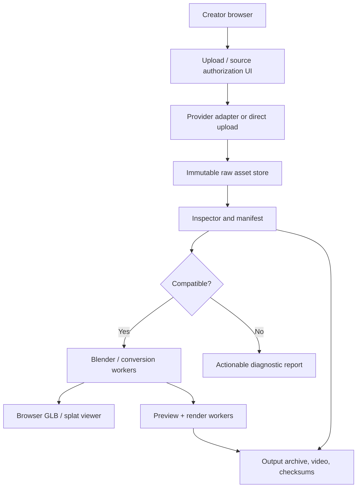

# Architecture proposal

## Goals
Browser-facing UX; headless cloud processing; open interfaces; reproducible tests; data provenance; provider adapters isolated from pipeline internals.



## Proposed components (not yet implemented)
- **Web frontend:** Three.js (for GLB/glTF), animation selector, provenance and error panels. For SPZ use a suitable maintained Gaussian-splat viewer; do not pretend Three.js GLTFLoader supports SPZ.
- **API backend:** Python (e.g. FastAPI) or TypeScript service for jobs, session authorization, manifests and asset metadata.
- **Asset store:** object storage or private artifacts; raw unmodified input with SHA-256 key; derived files with parent source hashes.
- **Adapters:** provider-specific `probe`, `authorize`, `download`, `inspect_metadata` and `report_error` contract. Authentication flows must be official and lawful.
- **Inspection:** fast standard-library glTF header/JSON checks first, Blender process for FBX and skeletal/visual audit.
- **Workers:** Blender Python background `-b`, ffmpeg for encoded video, GPU where supported; explicit job package for Kaggle rather than an assumed API link.
- **Monitoring:** structured JSON diagnostics, human-readable summary, stage timing, checksums, attempt count, redacted URLs.

## Proposed directory layout
```
.github/workflows/           CI and manual validation
docs/                        Product, design, decisions, operational guides
src/download3d/              Standard-library inspection CLI MVP
tests/                       Pure offline fixtures and negative cases
scripts/                     Blender automation (later)
web/                         Browser viewer (later)
examples/                    Permissive/synthetic fixtures + scene recipes
```

## State machine
`NEW -> RIGHTS_CHECK -> SOURCE_READY -> DOWNLOADING -> STORED -> INSPECTED -> (CONVERTED) -> PACKAGED -> DONE`

Failures are terminal only after classified retries or explicit cancellation. States should never imply file presence unless size and SHA-256 are verified. Distinguish `AUTH_REQUIRED`, `FORBIDDEN`, `EXPIRED_URL`, `PROXY_DENIED`, `DNS_FAILURE`, `WRONG_MODEL_ID`, `WRONG_MIME`, `ASSET_INCOMPLETE`, `ANIMATIONS_MISSING`, `BLENDER_IMPORT_FAILURE`, and `EXPORT_NOT_SUPPORTED`.

## Security/data boundaries
- Browser never exposes provider API keys to unrelated websites or client logs.
- Workers reject internal-network URL fetches and signed-link leakage. Avoid downloader endpoints accepting arbitrary untrusted URLs.
- Input archive handling must reject zip-slip, symlinks and decompression bombs.
- GitHub Actions uses least-privilege read access; never place provider cookies in code, workflow inputs or logs.
- No raw public user-submitted asset uploads to git. Private object storage should have retention policy and access control.

## Engineering tradeoffs
- glTF/GLB is a good *preview/delivery* format, Blender `.blend` is an editable workspace file, FBX supports many skeleton workflows, SPZ is an optimized splat representation.
- For large or complex scenes, use asset references, LODs, texture budgets, lazy loading and modular scene manifests.
- Prefer native Blender rigging/animation for independently movable car/prop components over hoping a character auto-rigger understands mechanics.
